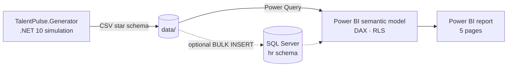

# TalentPulse – HR & Recruiting Analytics

[](https://github.com/tibortoth8807/TalentPulse/actions/workflows/ci.yml)


**People analytics dashboard for a 2,000-person international company: headcount, attrition, recruiting funnel, time to fill and cost per hire – in one Power BI report.**

Every HR team asks the same questions: *How many people do we have? Who is leaving and why? How long does hiring take, and which channel is worth the money?*
TalentPulse answers them with a production-style setup: a .NET data generator, a star schema, documented KPIs, DAX measures,
row-level security per country, and a Power BI report stored as a git-friendly **Power BI Project (PBIP)**.

> All data is **synthetic** – a fictional company ("Northwind Dynamics", 6 countries, 15 departments, ~4 years of history), generated with a fixed seed. No real person is in it, so the repository can be public.

<!-- Add after building the report:

-->

## Questions the report answers

| Page | Business question | Key KPIs |
|---|---|---|
| **Executive Overview** | How is our workforce developing? | Headcount, YoY growth, attrition (rolling 12 months), open requisitions |
| **Recruiting Funnel** | Where do we lose candidates, and which source is worth its cost? | Funnel conversion, time to fill / hire, offer acceptance, cost per hire, source hire rate |
| **Attrition & Retention** | Who leaves, when and why? | Voluntary vs. involuntary attrition, early leavers %, department × country heatmap, exit reasons |
| **Workforce Structure** | What does our organization look like? | Levels, gender split, work model (office / hybrid / remote), age and tenure |
| **Department detail** (drill-through) | What is going on in one department? | Trend, open roles and their age |

All KPI definitions: [docs/kpi-definitions.md](docs/kpi-definitions.md).

## Skills demonstrated

| Area | What |
|---|---|
| Power BI | Power BI Project (PBIP) in git, Power Query (M), star schema, semi-additive measures, rolling-12-month KPIs, inactive relationships with `USERELATIONSHIP`, dynamic **row-level security**, drill-through, field parameters, custom theme |
| Data modeling | Kimball-style facts & conformed dimensions, monthly snapshot fact, event fact, accumulating-snapshot style funnel fact |
| .NET | .NET 10 / C# simulation engine (attrition, backfills, growth plan, recruiting funnel, promotions), deterministic seeds, CSV export |
| Quality | xUnit tests for data invariants (no future dates, ordered funnel stages, snapshot = active employees), CI on GitHub Actions |
| SQL | SQL Server star schema DDL with keys and indexes, bulk-load script |
| Business | HR KPI dictionary written for HR stakeholders, not only for developers |

## Architecture



| Table | Type | Grain |
|---|---|---|
| `HeadcountMonthly` | periodic snapshot fact | employee × month-end |
| `EmployeeEvent` | transaction fact | hire / termination / promotion |
| `Requisition` | accumulating snapshot fact | job opening (opened → filled / cancelled) |
| `Application` | accumulating snapshot fact | candidate × requisition (applied → screened → interviewed → offered → hired) |
| `Calendar`, `OrgUnit`, `Location`, `Job`, `Source`, `Employee` | dimensions | |

Model details, relationships and RLS: [powerbi/model.md](powerbi/model.md).

## Run it

```bash
# 1. Generate the dataset (about 2 seconds)
dotnet run --project src/TalentPulse.Generator -- --out data

# 2. Tests
dotnet test TalentPulse.slnx
```

The generator prints the headline KPIs – the Power BI cards must show the same numbers:

```
  Headcount at start / as-of:   ~1,760 / ~2,150
  Attrition, last 12 months:    ~14 %
  Avg time to fill (days):      ~50
```

Options: `--seed 42 --start 2023-01-01 --asof 2026-10-31 --headcount 1800 --growth 0.06`

**Open the report:** `powerbi/TalentPulse.pbip` in Power BI Desktop (set the `DataFolder` parameter to your `data\` path).
Building it from scratch: [powerbi/README.md](powerbi/README.md).

## Repository layout

| Path | What |
|---|---|
| `src/TalentPulse.Generator` | Simulation engine and CSV export |
| `tests/TalentPulse.Tests` | Data invariant tests |
| `data/` | Generated CSV files (committed, so the report opens without running .NET) |
| `powerbi/` | PBIP report, Power Query scripts, DAX measures, model and report specs, theme |
| `sql/` | Optional SQL Server star schema and load script |
| `docs/` | KPI dictionary, screenshots |

## Roadmap

- [ ] Report pages and screenshots (in progress)
- [ ] Headcount forecast vs. plan (what-if parameter for growth and attrition)
- [ ] Incremental refresh on the SQL Server source
- [ ] Personal page: anonymized funnel of my own job search

## Author

**Tibor Tóth** – Senior .NET Developer with Power BI / Power Platform background
[LinkedIn](https://www.linkedin.com/in/tibor-t%C3%B3th-a353b38b) · Other projects: [VulnLens](https://github.com/tibortoth8807/VulnLens) · [AccessDesk](https://github.com/tibortoth8807/AccessDesk) · [PartFinder](https://github.com/tibortoth8807/AutoWebshopPartfinder)
