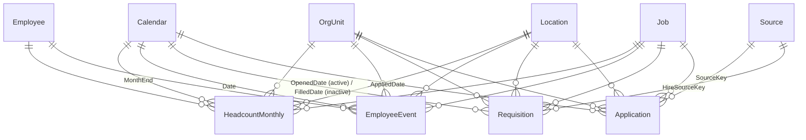

# Semantic model

Star schema with three fact tables sharing conformed dimensions. Every fact carries its own dimension keys
(org unit, location, job at the time of the event), so there are **no ambiguous filter paths** and no bi-directional relationships.



## Tables

| Table | Grain | Source file |
|---|---|---|
| `Calendar` | one row per day | `dim_date.csv` – mark as date table (Table tools → Mark as date table → `Date`) |
| `Location` | city | `dim_location.csv` |
| `OrgUnit` | department (with function) | `dim_org_unit.csv` |
| `Job` | job title = department × level | `dim_job.csv` |
| `Source` | recruiting source | `dim_source.csv` |
| `Employee` | employee (current attributes) | `dim_employee.csv` |
| `SecurityUserCountry` | user ↔ country (RLS) | `security_user_country.csv` – **no relationships** |
| `HeadcountMonthly` | employee × month-end (snapshot) | `fact_headcount_monthly.csv` |
| `EmployeeEvent` | hire / termination / promotion | `fact_employee_event.csv` |
| `Requisition` | job opening | `fact_requisition.csv` |
| `Application` | candidate × requisition | `fact_application.csv` |

## Relationships (Model view)

All **many-to-one, single direction**, from fact to dimension.

| From (many) | To (one) | Active |
|---|---|---|
| `HeadcountMonthly[MonthEnd]` | `Calendar[Date]` | ✅ |
| `HeadcountMonthly[EmployeeKey]` | `Employee[EmployeeKey]` | ✅ |
| `HeadcountMonthly[OrgUnitKey]` / `[LocationKey]` / `[JobKey]` | `OrgUnit` / `Location` / `Job` | ✅ |
| `EmployeeEvent[Date]` | `Calendar[Date]` | ✅ |
| `EmployeeEvent[EmployeeKey]` | `Employee[EmployeeKey]` | ✅ |
| `EmployeeEvent[OrgUnitKey]` / `[LocationKey]` / `[JobKey]` | `OrgUnit` / `Location` / `Job` | ✅ |
| `Requisition[OpenedDate]` | `Calendar[Date]` | ✅ |
| `Requisition[FilledDate]` | `Calendar[Date]` | ❌ inactive – used via `USERELATIONSHIP` |
| `Requisition[OrgUnitKey]` / `[LocationKey]` / `[JobKey]` | `OrgUnit` / `Location` / `Job` | ✅ |
| `Requisition[HireSourceKey]` | `Source[SourceKey]` | ✅ |
| `Application[AppliedDate]` | `Calendar[Date]` | ✅ |
| `Application[SourceKey]` | `Source[SourceKey]` | ✅ |
| `Application[OrgUnitKey]` / `[LocationKey]` / `[JobKey]` | `OrgUnit` / `Location` / `Job` | ✅ |

Do **not** relate `Employee` to `OrgUnit` / `Location` / `Job`, or `Job` to `OrgUnit` – the facts already carry those keys,
and the extra paths would make the model ambiguous. Power BI may auto-detect some relationships on load: delete the ones not in this table
(File → Options → Current file → Data load → untick *Autodetect new relationships* before loading).

Hide all key columns and the raw date columns that are replaced by measures (right click → Hide in report view).

## Calculated table: FunnelStage

Modeling → New table:

```dax
FunnelStage =
DATATABLE (
    "Stage", STRING,
    "StageOrder", INTEGER,
    {
        { "Applied", 1 },
        { "Screened", 2 },
        { "Interviewed", 3 },
        { "Offered", 4 },
        { "Hired", 5 }
    }
)
```

Sort `FunnelStage[Stage]` by `StageOrder`. No relationships.

## Calculated columns

```dax
// HeadcountMonthly
Tenure Band =
SWITCH (
    TRUE (),
    HeadcountMonthly[TenureMonths] < 12, "< 1 year",
    HeadcountMonthly[TenureMonths] < 36, "1-3 years",
    HeadcountMonthly[TenureMonths] < 60, "3-5 years",
    "5+ years"
)

Tenure Band Order =
SWITCH ( TRUE (), HeadcountMonthly[TenureMonths] < 12, 1, HeadcountMonthly[TenureMonths] < 36, 2, HeadcountMonthly[TenureMonths] < 60, 3, 4 )

Age Band =
SWITCH ( TRUE (), HeadcountMonthly[Age] < 25, "< 25", HeadcountMonthly[Age] < 35, "25-34", HeadcountMonthly[Age] < 45, "35-44", HeadcountMonthly[Age] < 55, "45-54", "55+" )

// EmployeeEvent - tenure of leavers
Tenure at Event (months) =
DATEDIFF ( RELATED ( Employee[HireDate] ), EmployeeEvent[Date], MONTH )
```

## Sort-by-column

| Column | Sort by |
|---|---|
| `Calendar[MonthName]` | `Calendar[MonthNumber]` |
| `Job[Level]` | `Job[LevelOrder]` |
| `HeadcountMonthly[Tenure Band]` | `HeadcountMonthly[Tenure Band Order]` |
| `FunnelStage[Stage]` | `FunnelStage[StageOrder]` |

## Measure formats

| Measures | Format |
|---|---|
| Headcount, FTE, Hires, Leavers, Promotions, Requisitions…, Applications, Screened, Interviewed, Offers | Whole number, thousands separator |
| …Rate…, …%, Attrition…, Conversion | Percentage, 1 decimal |
| Avg / Median Time to Fill / Hire, Average Tenure, Average Age | Decimal, 1 decimal |
| Hiring Cost, Cost per Hire | Currency €, 0 decimals |
| As Of Date | Date (yyyy-mm-dd) |

## Row-level security (dynamic)

A regional HR business partner must only see their own countries. Modeling → Manage roles → New role **"Country HR"**:

| Table | Filter (DAX) |
|---|---|
| `Location` | `[Country] IN CALCULATETABLE ( VALUES ( SecurityUserCountry[Country] ), SecurityUserCountry[UserEmail] = USERPRINCIPALNAME () )` |
| `Employee` | `[LocationKey] IN CALCULATETABLE ( VALUES ( Location[LocationKey] ), Location[Country] IN CALCULATETABLE ( VALUES ( SecurityUserCountry[Country] ), SecurityUserCountry[UserEmail] = USERPRINCIPALNAME () ) )` |
| `SecurityUserCountry` | `[UserEmail] = USERPRINCIPALNAME ()` |

The `Location` filter flows to all four facts. `Employee` needs its own filter because it is a dimension with no path from `Location`
(otherwise an employee table visual would list everybody).

Test it: Modeling → View as → tick **Other user** = `hr.budapest@northwind.example` and role **Country HR** → only Budapest data remains.
Other demo users: `hr.dach@…` (Germany), `hr.emea@…` (EMEA countries), `hr.global@…` (everything).
